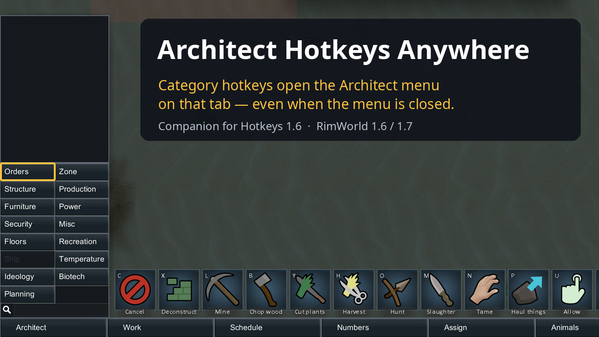

# Architect Hotkeys Anywhere



A small RimWorld companion mod for **Hotkeys 1.6** (mitasamodel's fork, `Aze.Hotkeys.Fork.mitasamodel`).

Hotkeys lets you bind a key to each Architect category ("Orders tab", "Structure tab", ...), but
those keys only work while the Architect menu is **already open**: you have to press the
Architect key first, then the category key. With this mod, pressing a category key while the menu
is closed opens the Architect menu directly on that category.

- Uses the bindings Hotkeys already defines (Options → Keyboard → *Architect Hotkeys*); adds none of its own.
- While the Architect menu is open, nothing changes — Hotkeys handles the key as before.
- Ignored while typing in a text field, while a modal dialog is open, or on the world map.
- No Harmony patch, no hard dependency. Contains no code from Hotkeys.

Tested on RimWorld 1.6.4871 and 1.7.4984 (unstable branch).

## Get it

- Steam Workshop: https://steamcommunity.com/sharedfiles/filedetails/?id=3824191022

## Requirements

- [Hotkeys 1.6](https://steamcommunity.com/sharedfiles/filedetails/?id=3536306259) with
  *Architect Hotkeys* enabled in its mod settings.
- Load this mod after Hotkeys.

## Install

Copy `About/` and `Assemblies/` into `RimWorld/Mods/ArchitectHotkeysAnywhere/`.
The included DLL is built against 1.6 and runs unchanged on 1.7.

To build it yourself you need the .NET SDK (8 or later) and a **RimWorld 1.6** install — the
project references the game's `RimWorldLinux_Data/Managed/*.dll`, which the 1.7 unstable branch
no longer has:

```bash
tools/deploy.sh /path/to/RimWorld   # builds Source/ and copies About + Assemblies into Mods/
```

On Windows pass `-p:ManagedDir=<RimWorld>/RimWorldWin64_Data/Managed` to `dotnet build` instead.

## How it works

Hotkeys reads its category bindings inside `MainTabWindow_Architect.ExtraOnGUI`, which only runs
while the Architect window is open. This mod's `GameComponent.GameComponentOnGUI` runs on every
GUI event during play; on a matching key press with the window closed it consumes the event,
opens the Architect tab and selects that category.

## License

MIT — see [LICENSE](LICENSE).
